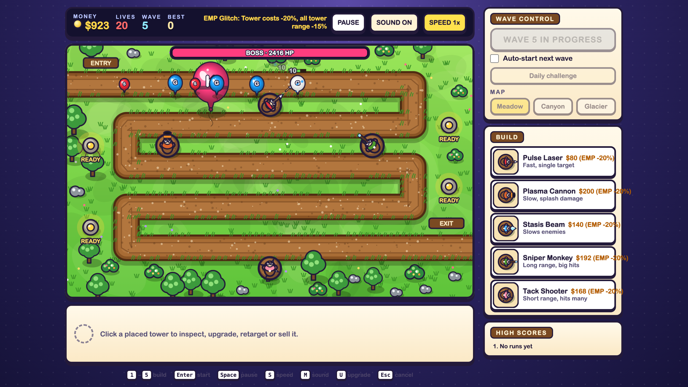

# Neon Tower Defense

A browser tower defense game. Place towers along the path, upgrade them, pick a specialisation at Tier 3, and stop waves of enemies before they leak through. Every fifth wave is a boss wave.

**[Play it live](https://bumair.github.io/neon-tower-defense/)** · made with plain HTML, CSS and JavaScript, no libraries.

## Towers

Each tower can be upgraded to Tier 2 for a stat boost. At Tier 3 you choose one of two paths, and the path is permanent.

| Tower | Cost | Base | Tier 3 paths |
| --- | --- | --- | --- |
| Pulse Laser | $100 | Fast single-target laser | **A** Multi-shot: hits up to 3 foes · **B** Overcharge: fires 60% faster |
| Plasma Cannon | $250 | Slow shells with splash | **A** Cluster: splash radius ×1.7 · **B** Heavy: shells hit 50% harder |
| Stasis Beam | $175 | Weak beam that slows | **A** Deep Freeze: slows to 30% for 3s · **B** Chain Chill: also chills the next foe |
| Sniper Monkey | $240 | Long range, big hits on the foe furthest along the path | **A** Armor Piercing: ignores armor · **B** Rapid Bolt: fires 40% faster |
| Tack Shooter | $210 | Short range, hits up to 6 foes at once | **A** Razor: double damage tacks · **B** Spread: range ×1.35, hits up to 9 foes |

## Enemies

| Letter | Enemy | Appears from | Notes |
| --- | --- | --- | --- |
| S | Scout | Wave 1 | Fast, fragile |
| G | Soldier | Wave 1 | The standard foe |
| T | Tank | Wave 4 | 200 base HP |
| A | Armored | Wave 6 | Takes half damage from every hit |
| B | Behemoth | Wave 5 | Tough, leaks cost 2 lives |
| W | Swarm | Wave 7 | Very fast, very fragile, shows up in numbers |
| D | Shielded | Wave 8 | A shield absorbs the first hits before HP is touched |
| K | Boss | Every 5th wave | Leads its wave with a health bar across the top, 5 lives. Its escort follows behind. |

Enemy HP grows about 10% per wave for the first five waves, then about 14% per wave. Waves get bigger as they go.

## Events

From wave 3, each wave has a chance of one of these events, shown in the HUD:

- **Solar Flare:** Pulse Lasers and Stasis Beams fire 50% faster.
- **EMP Glitch:** towers cost 20% less, but all tower range drops by 15%.
- **Scout Rush:** enemies move 30% faster with 40% less HP.

## Maps

Choose **Meadow**, **Canyon** or **Glacier** before the first wave. Each map has its own path and overload pylon positions. The map locks once a run starts.

## How to play

1. Pick a tower from the **Build** panel (or press `1`–`5`), then click the field to place it. Hold `Shift` to place several.
2. Click a placed tower to upgrade it, retarget it or sell it. At Tier 3, pick path **A** or **B** in the inspector.
3. Click a gold **READY** pylon to fire a stun shockwave. It recharges after 30 seconds.
4. Press **Start wave** (or `Enter`). Clearing a wave pays a bonus plus 5% interest on unspent money, up to $60.
5. With **Auto-start** on, the next wave starts after a short countdown. Press Start during the countdown to call it early for a small bonus.

Want a different challenge? Turn on **Daily challenge**. Everyone who plays on the same day gets the same enemy sequence, so you can compare runs.

## Keys

| Key | Action |
| --- | --- |
| `1`–`5` | Pick a tower |
| `Shift` + click | Place several towers |
| `Enter` | Start wave (or call it early during the auto-start countdown) |
| `Space` | Pause |
| `S` | Change speed |
| `M` | Sound on/off |
| `U` | Upgrade selected tower |
| `Esc` / right-click | Cancel placing |

The game pauses by itself when the tab is hidden. On phones and tablets, tap to place and select, and the keyboard shortcuts are hidden.

## Scores and saved settings

When a run ends you see a breakdown: damage and pops for each tower, waves cleared, lives lost and total pops. The game keeps your best wave, your top five runs (with map and Daily tag), and your sound and auto-start settings in your browser. Nothing is sent to a server.

## Run it locally

No install needed. Open `index.html` in a browser. Keep `style.css` and `game.js` in the same folder.

## Files

- `index.html`: page layout
- `style.css`: styling
- `game.js`: all game logic and drawing
